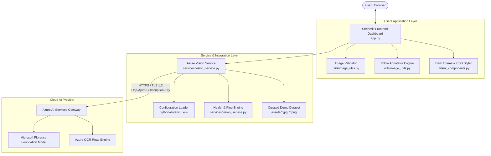
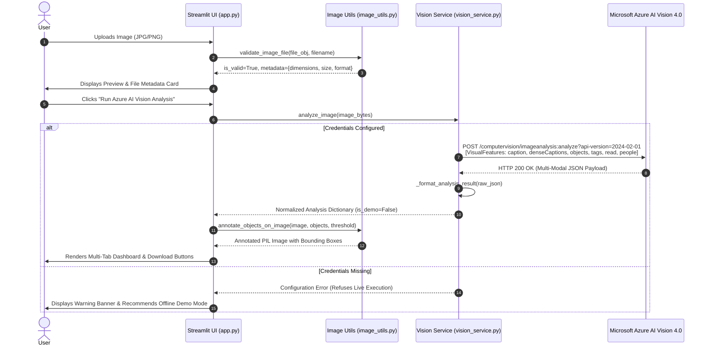

# System Architecture: AI-Based Image Recognition and Analysis System

---

## 1. High-Level Architectural Overview

The application follows a modular, three-tier microservice-consumer architecture. It decouples the visual presentation layer (Streamlit frontend) from the business and integration logic (`AzureVisionService`) and image processing utilities (`image_utils`).



---

## 2. Component Hierarchy and Module Responsibilities

### 2.1 Presentation Tier (`app.py` & `utils/ui_components.py`)
- **`app.py`:** Serves as the central controller. Manages navigation across 4 dedicated workspaces:
  1. *Live Image Analyzer* (Interactive user uploads and analysis execution)
  2. *Offline Demo Showcase* (Curated scenario inspection)
  3. *Architecture & AI-900 Concepts* (Curriculum alignment and educational cards)
  4. *Azure Configuration & Diagnostics* (Connection testing and setup guide)
- **`utils/ui_components.py`:** Injects a custom CSS design system featuring:
  - High-contrast near-black canvas (`#0A0E17`) and charcoal panels (`#141B2D`).
  - Azure blue (`#0078D4`) and cyan (`#38BDF8`) accents.
  - Custom metric containers, responsive tabs, confidence progress bars, and alert callouts.

### 2.2 Integration Tier (`services/vision_service.py`)
- **`AzureVisionService`:** Implements clean separation of cloud network communications.
  - **Sanitization:** Normalizes endpoint URLs, validates URI schemes, and ensures trailing slash conformity.
  - **Dual-Engine Execution:** Executes analysis using the modern `azure-ai-vision-imageanalysis` Python SDK with an automated fallback to direct REST API calls using `requests`.
  - **Diagnostic Engine:** Implements `test_connectivity()` to verify network reachability, API key validity, and latency without invoking costly operations.
  - **Zero-Trust Key Masking:** Automatically redacts API keys (`••••••••`) before passing values to UI layers or logs.
  - **Offline Preset Provider:** Returns structured demo responses explicitly marked with `is_demo: True`.

### 2.3 Image Processing Tier (`utils/image_utils.py`)
- **Input Validation:** Enforces format restrictions (`.jpg`, `.jpeg`, `.png`), checks magic bytes with Pillow, and validates file size (max 20 MB) and pixel dimensions (50 px to 16,000 px).
- **Bounding Box Annotation:** Employs an alpha-composited overlay using Pillow's `ImageDraw` module.
  - Dynamically calculates label badge geometry to prevent border clipping.
  - Applies a distinct high-contrast color palette (Cyan, Emerald, Amber, Coral, Violet).
  - Provides a confidence threshold slider to filter low-probability detections.
- **OCR Highlighting:** Overlays polygon coordinates around recognized text blocks.
- **Asset Synthesizer:** Programmatically constructs lightweight, high-fidelity sample images on first run if local demo files are missing.

---

## 3. End-to-End Data Flow Sequence



---

## 4. API Request and Response Specifications

### 4.1 Azure AI Vision 4.0 REST Endpoint
```http
POST https://<your-resource-name>.cognitiveservices.azure.com/computervision/imageanalysis:analyze?api-version=2024-02-01&features=caption,denseCaptions,tags,objects,read,people HTTP/1.1
Host: <your-resource-name>.cognitiveservices.azure.com
Ocp-Apim-Subscription-Key: <your-32-character-key>
Content-Type: application/octet-stream

<raw binary image bytes>
```

### 4.2 Standardized Analysis Result Schema
The service layer standardizes responses into the following JSON dictionary:

```json
{
  "success": true,
  "source": "azure_sdk_4.0",
  "is_demo": false,
  "model_version": "2024-02-01",
  "metadata": {
    "width": 1920,
    "height": 1080
  },
  "caption": {
    "text": "A modern electric car charging at an urban power station",
    "confidence": 0.942,
    "confidence_pct": 94.20
  },
  "dense_captions": [
    {
      "text": "a silver electric vehicle parked at a charger",
      "confidence": 0.915,
      "confidence_pct": 91.50,
      "bounding_box": {"x": 120, "y": 300, "width": 800, "height": 450}
    }
  ],
  "tags": [
    {"name": "vehicle", "confidence": 0.985, "confidence_pct": 98.50},
    {"name": "car", "confidence": 0.972, "confidence_pct": 97.20},
    {"name": "charging station", "confidence": 0.931, "confidence_pct": 93.10}
  ],
  "objects": [
    {
      "name": "car",
      "confidence": 0.94,
      "confidence_pct": 94.0,
      "bounding_box": {"x": 120, "y": 300, "width": 800, "height": 450}
    }
  ],
  "ocr": {
    "detected": true,
    "total_lines": 2,
    "total_words": 6,
    "lines": [
      {"text": "CHARGING STATION #4", "words_count": 3, "bounding_polygon": []},
      {"text": "FAST CHARGE 150KW", "words_count": 3, "bounding_polygon": []}
    ],
    "full_text": "CHARGING STATION #4\nFAST CHARGE 150KW"
  },
  "raw_json": { ... }
}
```

---

## 5. Security & Credential Protection Architecture

The system enforces strict security boundaries to prevent accidental credential leakage:
1. **Separation of Secrets:** Credentials are never hardcoded in source files. They reside in `.env`, which is explicitly blocked from source control via `.gitignore`.
2. **Template Distribution:** A safe `.env.example` file is provided containing descriptive documentation and dummy placeholders.
3. **Runtime Masking:** The service masks secret keys before any value is rendered in the UI or printed to console logs.
4. **Input Sanitization:** Uploaded files are decoded in-memory via `io.BytesIO`. No arbitrary user files are written to system disk without format verification, mitigating file-inclusion and shell-injection vulnerabilities.
5. **No Synthetic Live Results:** If credentials are missing, the system never fabricates results and claims they came from Azure. It clearly prompts for configuration and routes to the labeled Demo Mode.
